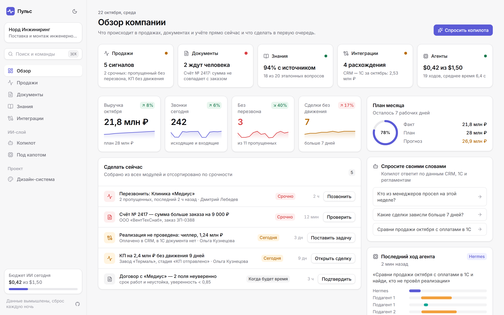
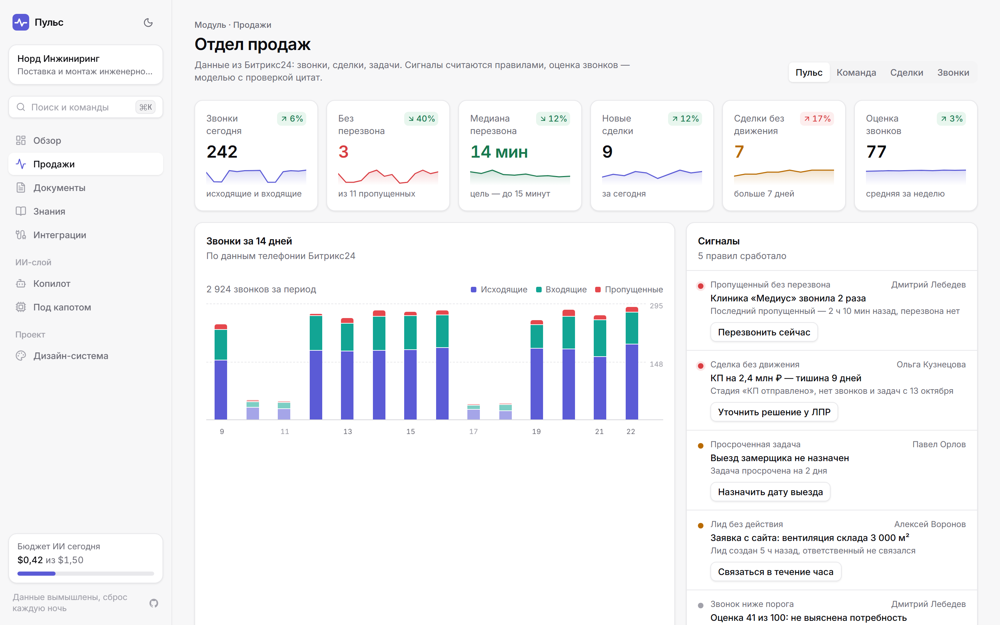
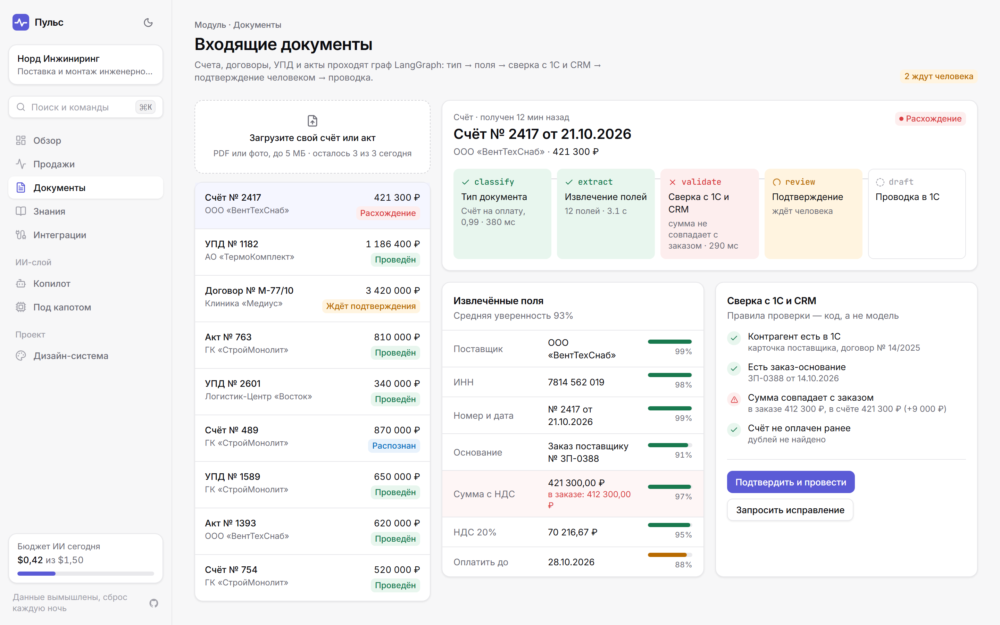
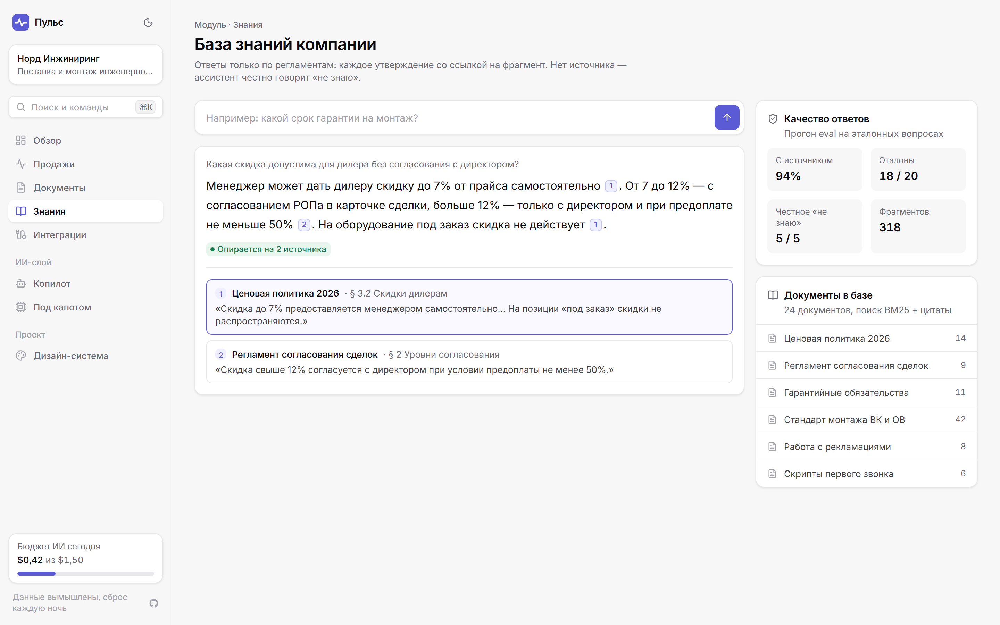
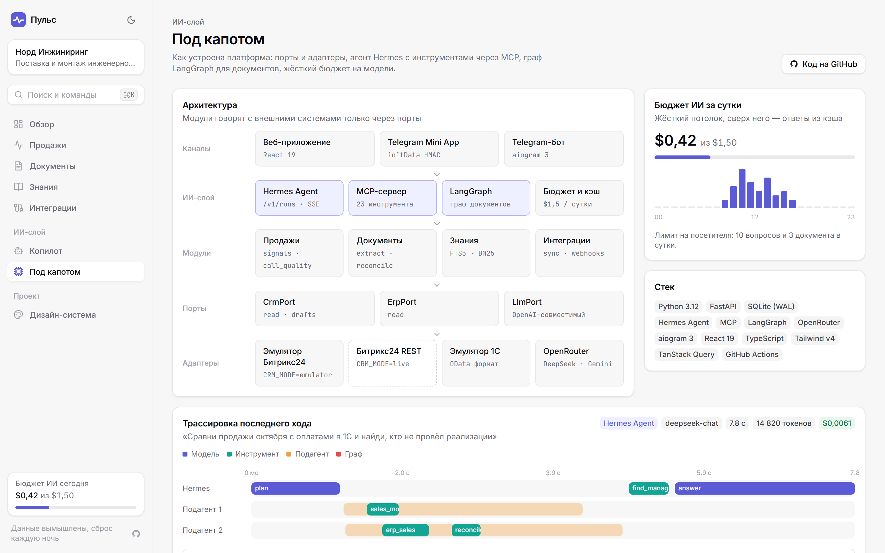

# ⚡ Пульс (Pulse AI Ops)

> **Открытая промышленная платформа операционного управления бизнесом на базе ИИ-агентов.**  
> Объединяет управление отделом продаж (Битрикс24), учет и склад (1С), интеллектуальный документооборот (LangGraph), корпоративную базу регламентов (RAG) и оркестрацию агентов (Hermes Agent + MCP).

[](https://github.com/ZonaNeona/pulse-ai-ops/actions/workflows/ci.yml)
[](https://www.python.org/downloads/)
[](tests/)
[](https://fastapi.tiangolo.com/)
[](https://langchain-ai.github.io/langgraph/)
[](https://react.dev/)
[](https://tailwindcss.com/)
[](https://docs.aiogram.dev/)
[](https://opensource.org/licenses/MIT)

🌐 **Живой демонстрационный стенд:** [https://demo.shvarev-demo.ru](https://demo.shvarev-demo.ru)  
📱 **Telegram Mini App:** поддерживается нативно (доступ через бот и мобильный интерфейс)  
📊 **Трекер выполнения проекта:** [https://progress.shvarev-demo.ru/rop-roadmap/](https://progress.shvarev-demo.ru/rop-roadmap/)

---



---

## 🎯 Что решает «Пульс»

В современном B2B-бизнесе данные разорваны: менеджеры ведут сделки в CRM, бухгалтерия и склад работают в 1С, первичные документы пересылаются в почте и мессенджерах, а регламенты пылятся в разрозненных файлах. РОП и генеральный директор тратят часы на ручной сбор отчетов и поиск расхождений.

«Пульс» выступает **интеллектуальным операционным центром (Ops CoPilot)** поверх инфраструктуры компании:

1. **Мониторинг продаж и оперативные сигналы (Sales Ops):**
   - 7 автоматических правил контроля (зависшие крупные сделки, забытые лиды, клиенты без коммуникации, просевшие менеджеры).
   - Рейтинг команды и контроль соблюдения суточных нормативов активности (звонки, длительность, конверсии).
   - **AI-аудит звонков:** автоматический разбор аудиозаписей переговоров моделью по чек-листу РОПа с точным цитированием фраз менеджера/клиента и практическими рекомендациями.

2. **Интеллектуальный документооборот (LangGraph StateGraph):**
   - Автономный конвейер распознавания входящих счетов, актов и договоров: `classify` $\to$ `extract` $\to$ `validate (сверка с 1С)` $\to$ `human-approval` $\to$ `post`.
   - **Человек в контуре (Human-in-the-loop):** процесс гарантированно останавливается перед проводкой, ожидая подтверждения ответственного сотрудника в вебе или через кнопку в Telegram.
   - Персистентность потоков через SQLite Checkpoints (`SqliteSaver`).

3. **Корпоративная база знаний и регламентов (RAG):**
   - Полнотекстовый поисковый индекс FTS5 с токенизацией `unicode61` и ранжированием BM25 по 24 корпоративным регламентам.
   - Ответы со строгими ссылками на первоисточники `[1]`, `[2]` и защитой от галлюцинаций (100% честный отказ «не знаю», если информации нет в регламентах).
   - **Golden Eval Suite:** встроенный контрольный набор из 20 сценариев (pass rate **95.0%**, отклик 17 мс).

4. **Сквозная сверка CRM $\leftrightarrow$ 1С (ERP Reconciliation):**
   - Автоматическое сопоставление сущностей: «Выиграно в Битрикс24» vs «Оплачено и проведено в 1С».
   - Мгновенное выявление кассовых разрывов, отгрузок без оплаты и расхождений в суммах счетов.

5. **ИИ-Копилот и прозрачность «Под капотом» (Hermes Agent + MCP):**
   - Единый диалог на естественном языке поверх всех бизнес-модулей через открытый протокол **Model Context Protocol (FastMCP 2.x)**.
   - Живая трассировка последнего шага агента: используемые инструменты, подагенты, токены, задержка и стоимость запроса.
   - Двухфазный бюджетный предохранитель с жестким потолком **$1.50 в сутки**.

6. **Telegram-бот и Mini App (TMA):**
   - Полнофункциональный бот на `aiogram 3.31`: сводка дня `/today`, рейтинг команды `/team`, документы `/doc`.
   - Нативная интеграция Telegram Mini App: синхронизация сессий `pulse_visitor_id = tg_{user.id}`, валидация `initData` по HMAC-SHA256, поддержка темы и жестов.

---

## 📸 Галерея экранов системы

| Экран «Продажи и Пульс РОПа» | Экран «Документы (LangGraph)» |
| :---: | :---: |
|  |  |
| **Экран «База знаний (RAG)»** | **Экран «Под капотом (Трассировка MCP)»** |
|  |  |

---

## 🏛 Архитектура системы

Система построена по канонам **Гексагональной архитектуры (Ports & Adapters)** с чистым разделением интерфейсов, доменной логики и инфраструктурных драйверов:

```
                            ┌─────────────────────────────────────────┐
                            │    Клиентские интерфейсы (Frontends)    │
                            │  React 19 + Tailwind v4 │ Telegram TMA  │
                            └───────────────────┬─────────────────────┘
                                                │ REST / WebSockets / WebApp
                                                ▼
┌────────────────────────────────────────────────────────────────────────────────────────┐
│                              Pulse Core (FastAPI / Python 3.12)                        │
│                                                                                        │
│   ┌────────────────────┐   ┌─────────────────────┐   ┌─────────────────────────────┐   │
│   │   Modules: Sales   │   │    Modules: Docs    │   │      Modules: Knowledge     │   │
│   │   (Signals & Team) │   │ (LangGraph Pipeline)│   │       (FTS5 RAG & Eval)     │   │
│   └─────────┬──────────┘   └──────────┬──────────┘   └──────────────┬──────────────┘   │
│             │                         │                             │                  │
│             ▼                         ▼                             ▼                  │
│    ┌──────────────────┐      ┌──────────────────┐        ┌────────────────────────┐    │
│    │     CrmPort      │      │     ErpPort      │        │     Agents & Tools     │    │
│    │ (Абстрактный CRM)│      │ (Абстрактный ERP)│        │   (Hermes + FastMCP)   │    │
│    └────────┬─────────┘      └────────┬─────────┘        └──────────┬─────────────┘    │
└─────────────┼─────────────────────────┼─────────────────────────────┼──────────────────┘
              │                         │                             │
              ▼                         ▼                             ▼
   ┌──────────────────────┐  ┌──────────────────────┐     ┌──────────────────────┐
   │       Адаптеры       │  │       Адаптеры       │     │     Провайдеры LLM   │
   │  • BitrixRestAdapter │  │  • ODataErpAdapter   │     │  • OpenRouter / V3   │
   │  • EmulatorCrm       │  │  • EmulatorErp       │     │  • DeepSeek / Gemini │
   └──────────────────────┘  └──────────────────────┘     └──────────────────────┘
```

### Ключевые архитектурные решения (ADR):
- [ADR-001: Архитектура портов и адаптеров CRM/ERP](docs/adr/0001-ports-and-adapters.md)
- [ADR-002: Архитектура «Двух мозгов»: Hermes Agent (MCP) vs LangGraph](docs/adr/0002-dual-brain-architecture.md)
- [ADR-003: Двухфазный бюджетный предохранитель AI ($1.50/сутки)](docs/adr/0003-ai-budget-ceiling.md)
- [ADR-004: Реалистичные эмуляторы со срезами данных вместо фиктивных моков](docs/adr/0004-realistic-emulator-snapshots.md)
- [ADR-005: Персистентность потоков документов через LangGraph SQLite Checkpoints](docs/adr/0005-langgraph-sqlite-checkpoints.md)
- [ADR-006: Ночной сброс состояния стенда и динамическое «Сегодня»](docs/adr/0006-nightly-data-reset.md)

---

## 🚀 Быстрый старт

### Вариант 1: Запуск через Docker Compose (рекомендуется)

Клонируйте репозиторий и поднимите контейнеры одной командой:

```bash
git clone https://github.com/ZonaNeona/pulse-ai-ops.git
cd pulse-ai-ops
docker compose up -d
```

После старта будут доступны:
- 💻 **Веб-интерфейс «Пульс»:** [http://localhost:5180](http://localhost:5180)
- 📖 **Интерактивная API-документация Swagger:** [http://localhost:8010/api/docs](http://localhost:8010/api/docs)
- 🩺 **Health Check:** [http://localhost:8010/api/health](http://localhost:8010/api/health)

---

### Вариант 2: Локальная разработка

**Требования:** Python 3.12+, Node.js 22+, SQLite 3.35+

1. **Клонирование и настройка окружения:**
   ```bash
   git clone https://github.com/ZonaNeona/pulse-ai-ops.git
   cd pulse-ai-ops
   cp .env.example .env
   ```

2. **Запуск бэкенда (FastAPI):**
   ```bash
   cd apps/api
   python -m venv .venv
   source .venv/bin/activate       # На Windows: .venv\Scripts\activate
   pip install -e ".[dev]"
   uvicorn pulse.main:app --reload --port 8010
   ```

3. **Запуск клиентской части (React + Vite):**
   ```bash
   cd apps/web
   npm install
   npm run dev
   ```
   Фронтенд запустится на [http://localhost:5180](http://localhost:5180) с автоматическим проксированием API-запросов на порт 8010.

---

## 🔌 Подключение реальных систем (Битрикс24 и 1С)

По умолчанию платформа работает в режиме реалистичного эмулятора (`CRM_MODE=emulator`, `ERP_MODE=emulator`). Для переключения на живые корпоративные контуры достаточно указать параметры в файле `.env`:

### 1. Подключение Битрикс24 (Облако или Коробка)
```ini
CRM_MODE=live
BITRIX24_WEBHOOK_URL=https://your-company.bitrix24.ru/rest/1/your-inbound-webhook-token/
```
Система автоматически активирует `BitrixRestAdapter`, проверяет доступность сущностей `crm.deal.list`, `crm.activity.list`, `user.get` и начинает фоновый инкрементальный синк.

### 2. Подключение 1С:Предприятие 8.3 (OData)
```ini
ERP_MODE=live
ERP_ODATA_URL=https://1c.your-company.ru/base/odata/standard.odata/
ERP_ODATA_USER=pulse_sync_user
ERP_ODATA_PASSWORD=your_secure_password
```
Активируется `ODataErpAdapter`, запрашивающий сущности `Document_ЗаказКлиента`, `Document_РеализацияТоваровУслуг`, `Document_ПоступлениеБезналичныхДенежныхСредств`.

---

## 🧪 Качество кода, типизация и безопасность

Репозиторий оформлен в соответствии с требованиями Enterprise-разработки:

```bash
# 1. Проверка бэкенда (Линтинг, строгая типизация, тесты)
cd apps/api
ruff check .                                    # 0 замечаний
mypy pulse                                      # Strict mode, 0 ошибок в 62 файлах
pytest --cov=pulse --cov-report=term-missing   # 73 теста, покрытие 86%

# 2. Проверка фронтенда
cd apps/web
npm run lint                                    # ESLint 9 Flat Config (0 ошибок)
npm run typecheck                               # TypeScript 5.8 strict
npm test                                        # Vitest unit тесты
npm run build                                   # Сборка production-бандла

# 3. Санитарная проверка безопасности
python tools/check_private_names.py             # 0 закрытых терминов бывших заказчиков
```

---

## 📜 Лицензия

Проект распространяется под открытой лицензией **MIT License**. Подробности в файле [LICENSE](LICENSE).
